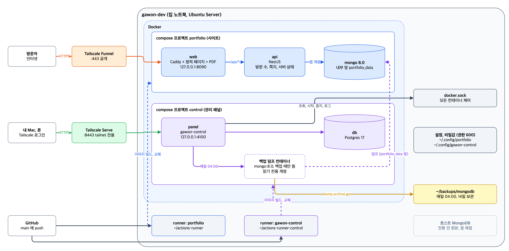
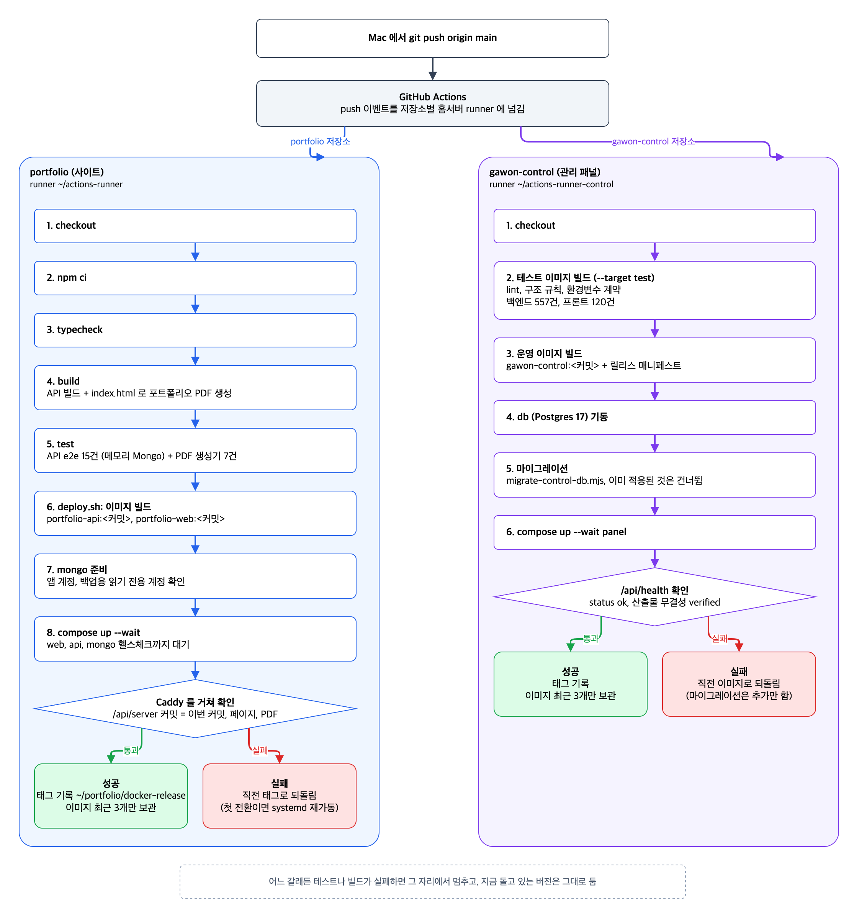

# portfolio

김가원 소개 및 포트폴리오 사이트. 홈서버 gawon-dev 에서 직접 운영함.

- 주소: https://gawon-dev.tail7c7524.ts.net (도메인 없이 Tailscale Funnel 로 공개)
- `main` 에 push 하면 홈서버의 GitHub Actions runner 가 테스트 후 자동 배포함

## 구조

```
apps/web/        정적 페이지 (index.html, style.css, app.js). 빌드 없음
apps/api/        NestJS 12 + Mongoose API (방문 수, 메시지, 서버 상태, 하이파이브)
scripts/         포트폴리오 PDF 생성기와 테스트, PDF 용 글꼴(IBM Plex Sans KR, OFL)
deploy/          배포 스크립트, Caddyfile, systemd 사용자 유닛, 1회성 서버 설정
.github/workflows/deploy.yml
```

## 페이지

책상을 위에서 내려다본 구도. 스티커 붙은 홈서버 노트북, 출력한 포트폴리오 한 장, 배포 영수증, 엽서로 구성함.

- 노트북 스티커는 끌어서 옮길 수 있음. 위치는 방문자 브라우저에만 저장
- 노트북 LED 와 영수증은 `/api/server` 를 10초마다 불러 실제 가동 시간, CPU 온도, 배터리, 배포 커밋을 보여 줌
- 오른쪽 위 스탠드 버튼으로 밝은 화면과 어두운 화면 전환
- 하이파이브 버튼: 연타를 모아 보내고, 한 사람이 하루 50번까지 셈
- `` ` `` 키를 누르면 숨은 터미널이 열림 (`help`, `neofetch`, `cat about`, `curl /api/health`, `pdf` 등)

## 포트폴리오 PDF

- `npm run build` 가 `apps/web/index.html` 을 읽어 `apps/web/gawon-portfolio.pdf` 를 만듦 (git 에는 안 올림)
- 페이지의 `data-pdf="..."` 표시가 PDF 에 들어갈 내용을 가리킴. 내용은 index.html 한곳만 고치면 됨
- 표시를 지우거나 구조를 바꿔서 내용을 못 찾으면 생성이 실패하고, 배포도 멈춤
- `npm test` 가 금지 문자(가운뎃점, em dash 등)와 '(이론상 비교)' 단서 누락도 검사함
- 로컬에서 바로 보려면 `npm run pdf`

## 다이어그램

원본은 `docs/diagrams/*.drawio` 이다. draw.io 앱으로 열어 고친 뒤 PNG 로 다시 내보낸다.

```bash
/Applications/draw.io.app/Contents/MacOS/draw.io --export --format png --scale 2 --border 24 \
  -o docs/diagrams/architecture.png docs/diagrams/architecture.drawio
```





## 서버 구성

포트폴리오는 Docker 컨테이너 세 개로 돎 (`deploy/docker-compose.yml`, 프로젝트 이름 `portfolio`).

```
인터넷 → Tailscale Funnel (HTTPS, gawon-dev:443)
           └─ 호스트 127.0.0.1:8090
                └─ web 컨테이너: Caddy + 정적 페이지      (deploy/web.Dockerfile, deploy/Caddyfile)
                     ├─ /      → /srv (apps/web, PDF 포함)
                     └─ /api/* → api 컨테이너 :3000      (apps/api/Dockerfile)
                                  └─ mongo 컨테이너 :27017 (mongo:8.0, 볼륨 portfolio_mongo-data)
```

- 호스트에 열리는 포트는 `127.0.0.1:8090` 하나뿐. Docker 로 연 포트는 UFW 를 거치지 않아서 반드시 127.0.0.1 로 묶음
- DB 망(`data`)은 인터넷으로 나가는 길이 없고, mongo 는 api 컨테이너에서만 닿음
- api 컨테이너는 `node` 사용자, 읽기 전용 파일 시스템으로 돎
- 노트북 센서(CPU 온도, 배터리)는 컨테이너에서도 호스트 `/sys` 가 그대로 보여서 따로 연결하지 않음

| 항목 | 위치 |
|---|---|
| 지금 돌고 있는 버전 | `~/portfolio/docker-release` (커밋 태그). 이미지는 `portfolio-api:<커밋>`, `portfolio-web:<커밋>` 최근 3개 보관 |
| API 환경변수 | `~/.config/portfolio/api.docker.env` (권한 600, git 에 없음) |
| Mongo 계정 | `~/.config/portfolio/mongo.env` (root 와 앱 계정 비밀번호, 권한 600) |
| 접속 로그 | `docker logs portfolio-web-1` (JSON, 10MB 5개까지 보관) |
| Actions runner | `~/actions-runner`, `github-runner.service` (사용자 유닛, docker 그룹) |
| 예전 방식 | `portfolio-api.service`, `caddy.service`, apt `mongod` 는 전환 뒤 꺼 둠. 되살리려면 `systemctl --user enable --now` |

자주 쓰는 명령 (서버에서):

```bash
cd ~/actions-runner/_work/portfolio/portfolio
export PORTFOLIO_CONFIG=~/.config/portfolio RELEASE=$(cat ~/portfolio/docker-release)
docker compose -f deploy/docker-compose.yml ps          # 상태
docker compose -f deploy/docker-compose.yml logs -f api  # API 로그
```

## 관리 패널 (gawon-control)

서버의 컨테이너는 관리 패널 [gawon-control](https://github.com/wongakim-99/gawon-control) 에서 봄 (kscold-control 기반, 비공개 저장소).

- 주소: `https://gawon-dev.tail7c7524.ts.net:8443` (Tailscale Serve, **내 tailnet 기기에서만** 열림. 공개 아님)
- tailnet 밖에서는 SSH 터널로: `ssh -L 4100:127.0.0.1:4100 homeserver` 후 `http://127.0.0.1:4100`
- 할 수 있는 것: 컨테이너 상태와 시작, 중지, 로그, 서버 CPU, 메모리, 디스크, Docker 정리, 웹 터미널(`docker` 명령), 감사 로그
- 백업: 대상 `portfolio` 를 매일 04:00 에 덤프, 14일 보관. 읽기 전용 계정(`portfolio-backup`)으로 내부 망(`portfolio_data`)에 붙어서 뜸. 파일은 서버 `~/backups/mongodb/portfolio/`
- 첫 관리자 비밀번호: 서버에서 `grep ADMIN_PASSWORD ~/.config/gawon-control/panel.env`

새 서비스(예: gawon-log 블로그)를 올릴 때도 같은 방식으로 함: 자기 저장소에 compose 를 두고, 포트는 `127.0.0.1` 로만 열고, DB 는 내부 망에 둠. 패널은 서버의 모든 컨테이너를 자동으로 보여 줌.


| 메서드 | 경로 | 설명 |
|---|---|---|
| GET | `/api/health` | DB 연결까지 확인. 배포 스크립트가 사용 |
| GET | `/api/views` | 누적 방문 수 |
| POST | `/api/views` | 방문 기록. 같은 방문자는 30분 안에 다시 와도 한 번만 셈 (TTL 인덱스) |
| POST | `/api/messages` | 메시지 남기기. IP 당 10분 3건, honeypot 으로 봇 차단 |
| GET | `/api/messages` | 최근 메시지 50건. `Authorization: Bearer <ADMIN_TOKEN>` 필요 |
| GET | `/api/server` | 가동 시간, 부하, 메모리, CPU 온도, 배터리, 배포 커밋. 5초 캐시 |
| GET | `/api/high-fives` | 누적 하이파이브 수 |
| POST | `/api/high-fives` | `{ "count": 1~10 }`. 한 사람 하루 50번까지, IP 당 1분 20회 |

메시지 확인 (서버에서):

```bash
source ~/.config/portfolio/api.docker.env
curl -s -H "Authorization: Bearer $ADMIN_TOKEN" http://127.0.0.1:8090/api/messages
```

## 로컬 개발

```bash
npm install
npm run dev        # PDF 생성 후 메모리 Mongo + API watch, http://127.0.0.1:3000 에서 페이지까지 확인
npm run typecheck
npm run build      # API 빌드 + 포트폴리오 PDF 생성
npm test           # API e2e 15건(메모리 Mongo) + PDF 생성기 7건
```

## 배포 흐름

1. GitKraken 이나 터미널에서 `main` 에 커밋, push
2. 홈서버 runner 가 `npm ci → typecheck → build(PDF 포함) → test → deploy/deploy.sh` 실행
3. `deploy.sh` 가 커밋 태그로 api, web 이미지를 만들고 `docker compose up --wait` 로 교체
4. Caddy 를 거쳐 `/api/server` 가 이번 커밋을 돌려주고 페이지와 PDF 가 열리는지 확인. 실패하면 직전 태그로 되돌림
5. 정적 파일은 `Cache-Control: no-cache` 로 내보내서 배포 직후 옛 CSS 가 남지 않음

진행 상황은 GitHub 저장소의 Actions 탭에서 확인.

## 처음 한 번만 한 설정

1. `deploy/root-setup.sh` 를 서버에서 `sudo bash` 로 실행: MongoDB 8.0 설치, 인증 켜기, tailscale operator 지정 (호스트 mongod 는 CI 테스트와 첫 전환 때 데이터 옮기기에 씀)
2. `deploy/server-setup.sh` 실행 (sudo 불필요): linger, Node, Actions runner 설치와 등록
3. Funnel 을 연결: `tailscale funnel --bg http://127.0.0.1:8090`
4. Docker 전환 (2026-10-11):
   - sudo 로 계정을 docker 그룹에 넣고 사용자 서비스 관리자를 다시 띄움: `sudo usermod -aG docker $USER && sudo systemctl restart user@$(id -u).service`
   - `deploy/docker-setup.sh` 실행 (sudo 불필요): `mongo.env`, `api.docker.env` 생성. HASH_SALT, ADMIN_TOKEN 은 기존 값 유지
   - 다음 push 의 `deploy.sh` 가 예전 API 를 멈추고 호스트 MongoDB 데이터를 컨테이너로 옮긴 뒤 교체함. 실패하면 예전 systemd 서비스를 다시 켬

docker 그룹은 사실상 root 권한이라 runner 를 거치는 이 저장소는 private 으로 유지함.

## 공개 전 확인할 것

- 소개 문장(회사에서, 학교에서, 집에서)은 본인 말투로 다시 쓰기 (`apps/web/index.html` 의 TODO 주석)
- 회사 항목은 보안서약서 기준(`~/.claude/skills/resume/security.md`)으로 한 번 더 확인
- 완성되면 `<meta name="robots" content="noindex">` 삭제
